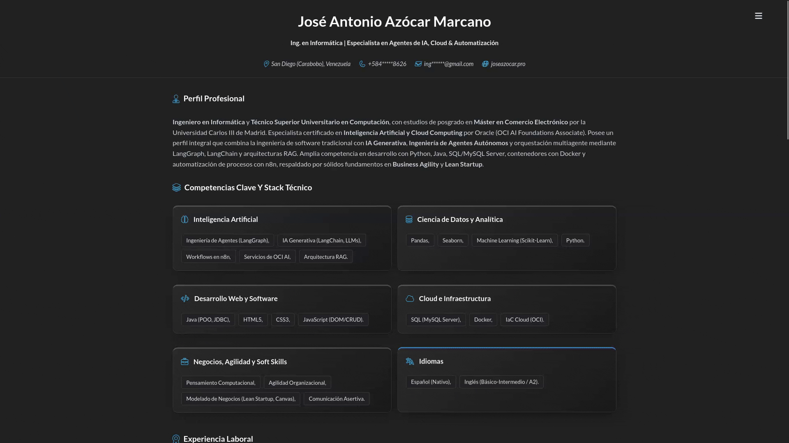

# 📑 CV Digital Multilingüe — Estilo Harvard & ATS Compatible | José Azócar

[](https://opensource.org/licenses/MIT)
[](https://www.netlify.com/)
[](https://developer.mozilla.org/es/docs/Web/HTML)
[](https://developer.mozilla.org/es/docs/Web/CSS)
[](https://developer.mozilla.org/es/docs/Web/JavaScript)
[](https://vitejs.dev/)
[](https://nodejs.org/)
[](https://supabase.com/)
[](https://curriculum.joseazocar.pro/)

Plataforma técnica de currículum digital de alto rendimiento, cuya maquetación para impresión está diseñada bajo los estándares visuales de la **Universidad de Harvard** y optimizada para la lectura de sistemas de seguimiento de candidatos (**ATS - Applicant Tracking System**). Desarrollada con una arquitectura modular orientada a dominios (**DDD**) en **JavaScript Vanilla (ES6+)**, empaquetada con **Vite**, y respaldada por una base de datos relacional en **Supabase (PostgreSQL)** con procedimientos **PL/pgSQL** y **Edge Functions**. Permite la conmutación de idiomas reactiva en tiempo real (Español/Inglés) sin recarga de página y adaptación dinámica de temas (Claro/Oscuro).

<div align="center">
    
</div><br>

🌐 **Sitio Web en Producción:** [curriculum.joseazocar.pro](https://curriculum.joseazocar.pro/)

---

## 📋 Tabla de Contenidos

- [🎯 Propósito y Visión General](#-propósito-y-visión-general)
  - [Problema que Resuelve y Caso de Uso](#problema-que-resuelve-y-caso-de-uso)
  - [Objetivos Clave](#objetivos-clave)
- [📁 Arquitectura y Estructura de Directorios](#-arquitectura-y-estructura-de-directorios)
- [🛠 Stack Tecnológico y Dependencias Clave](#-stack-tecnológico-y-dependencias-clave)
  - [Distribución del Código Base](#distribución-del-código-base)
  - [Herramientas y Frameworks](#herramientas-y-frameworks)
- [📐 Patrones de Diseño y Decisiones Técnicas](#-patrones-de-diseño-y-decisiones-técnicas)
- [🗄 Arquitectura de Base de Datos y Supabase Edge Functions](#-arquitectura-de-base-de-datos-y-supabase-edge-functions)
  - [Modelado y Esquema Multilingüe (PostgreSQL & PL/pgSQL)](#modelado-y-esquema-multilingüe-postgresql--plpgsql)
  - [Supabase Edge Functions (Lógica Serverless Backend)](#supabase-edge-functions-lógica-serverless-backend)
- [⚙ Configuración de Entorno y Backend](#-configuración-de-entorno-y-backend)
  - [Variables de Entorno](#variables-de-entorno)
  - [Configuración Local de `.env`](#configuración-local-de-env)
- [🔄 Puntos de Entrada y Ciclo de Ejecución](#-puntos-de-entrada-y-ciclo-de-ejecución)
- [💻 Instalación y Configuración Local](#-instalación-y-configuración-local)
- [⚖ Licencia y Propiedad Intelectual](#-licencia-y-propiedad-intelectual)

---

## 🎯 Propósito y Visión General

### Problema que Resuelve y Caso de Uso

Los archivos PDF tradicionales de currículum enfrentan serias limitaciones en los procesos de selección modernos:

1. **Inflexibilidad e Incompatibilidad ATS:** Muchos formatos gráficos complejos son rechazados o leídos incorrectamente por los sistemas automáticos de rastreo de candidatos (ATS).
2. **Gestión Multilingüe Dispersa:** Mantener versiones separadas en varios idiomas en documentos estáticos incrementa el riesgo de desactualización y errores de versión.
3. **Falta de Dinamismo:** Los perfiles estáticos no permiten la actualización centralizada e instantánea de proyectos, certificaciones y métricas profesionales.

Esta plataforma resuelve estos problemas proporcionando una solución web viva, indexable por motores de búsqueda, con compatibilidad ATS rigurosa y respaldo en base de datos.

### Objetivos Clave

- **Valor de Negocio:** Presentación ejecutiva limpia y estandarizada (estilo Harvard) que resalta la trayectoria de **José Antonio Azócar Marcano** (Ing. en Informática | Especialista en Agentes de IA, Cloud & Automatización).
- **Rendimiento (Performance-First):** Carga ultra-rápida sin dependencias pesadas de frameworks UI, optimizando cada byte mediante iconografía en línea y empaquetado optimizado con Vite.
- **Seguridad y Escalabilidad:** Conexión segura mediante Row Level Security (RLS) en PostgreSQL/Supabase y gestión de traducción mediante procedimientos PL/pgSQL en servidor.

---

## 📁 Arquitectura y Estructura de Directorios

El repositorio implementa un **Diseño Orientado a Dominios (DDD - Domain-Driven Design)** en JavaScript Vanilla, garantizando un desacoplamiento estricto entre la capa de presentación, la lógica de orquestación y el acceso a datos.

```text
curriculum/
├── assets/                  # Recursos estáticos (imágenes, gráficos, screenshots)
├── docs/                    # Documentación técnica extendida
│   └── database/            # Especificaciones y esquemas de la BD PostgreSQL
├── public/                  # Recursos estáticos que se copian tal cual al directorio raiz de la compilación (`dist/`)
├── src/                     # Código fuente modular de la aplicación
│   ├── app/                 # Capa de Aplicación (Controllers y orquestadores UI)
│   ├── core/                # Infraestructura Core (Configuración y cliente Supabase)
│   ├── modules/             # Dominios de Negocio (Contacto, Experiencia, Habilidades, etc.)
│   └── shared/              # Recursos Compartidos (Helpers, Templates HTML, componentes UI)
├── supabase/                # Migraciones, procedimientos PL/pgSQL y Edge Functions
├── .gitignore               # Exclusiones del control de versiones
├── LICENSE                  # Archivo de licencia de software libre MIT
├── README.md                # Documentación principal del proyecto
├── aliases.js               # Definición unificada de alias de rutas
├── generate-jsconfig.js     # Script de generación automática para jsconfig.json
├── index.html               # Punto de entrada HTML semántico principal
├── jsconfig.json            # Mapeo de rutas para soporte de autocompletado en IDE
├── package.json             # Manifiesto de dependencias y scripts de ejecucion
├── package-lock.json        # Bloqueo de versiones exactas de dependencias
├── robots.txt               # Directivas para rastreadores web (SEO)
├── sitemap.xml              # Mapa del sitio estructurado (SEO)
└── vite.config.js           # Configuración del bundler Vite y resolución de alias (@)
```

---

## 🛠 Stack Tecnológico y Dependencias Clave

### Distribución del Código Base

- **CSS3:** 45.8%
- **JavaScript (ES6+):** 36.9%
- **PL/pgSQL:** 10.0%
- **HTML5:** 5.1%
- **TypeScript:** 2.2%

### Herramientas y Frameworks

- **Frontend Core:** HTML5 Semántico, CSS3 estructurado bajo metodología **BEM**, y JavaScript moderno (ES6+).
- **Herramienta de Build:** **Vite**, encargado del empaquetado ultra-rápido, Hot Module Replacement (HMR) y resolución de alias de módulo.
- **Backend & Persistencia:** **Supabase (PostgreSQL 15+)** expuesto mediante API REST automática (PostgREST).
- **Lógica en Base de Datos:** Procedimientos almacenados en **PL/pgSQL** para la orquestación y consulta estructurada de datos multilingües.
- **Tooling Developer Experience:** Node.js, NPM, scripts de generación dinámica de configuración (`generate-jsconfig.js`).

---

## 📐 Patrones de Diseño y Decisiones Técnicas

1. **Domain-Driven Design (DDD):**
   - Separa de forma clara los módulos funcionales (`modules`), la capa de orquestación (`app`), la infraestructura de red (`core`) y las utilidades transversales (`shared`), evitando la degradación del código con el tiempo.
2. **Controller Orchestration (SPA Vanilla JS):**
   - Los controladores en `src/app` actúan como orquestadores de UI y flujo de datos sin requerir un pesado framework SPA (como React o Angular), manteniendo la huella del bundle al mínimo.
3. **Dual-Language Engine (Conmutador Reactivo ES/EN):**
   - Permite la alternancia de idioma instantánea mediante renderizado reactivo de plantillas HTML dinámicas en el cliente sin recargar la página.
4. **Metodología BEM (Block Element Modifier) en CSS:**
   - Mantiene especificidad CSS plana (un solo nivel de clase), evitando conflictos de cascada y garantizando modularidad visual.
5. **Iconografía In-line (Data URIs / SVG):**
   - Elimina solicitudes HTTP adicionales para iconos, mejorando la puntuación en Google Lighthouse y el tiempo de primer dibujado con contenido (FCP).
6. **Viewport Adaptativo con `dvh`:**
   - Utiliza unidades de alto de pantalla dinámicas (`dvh`) para prevenir solapamientos causados por la barra de navegación de navegadores móviles modernos (iOS Safari / Android Chrome).
7. **Gestión Resiliente de Datos:**
   - Implementación de `async/await` con manejo explícito de errores y renderizado proactivo de estados de interfaz (`Loading UI` y `Error UI`).

---

## 🗄 Arquitectura de Base de Datos y Supabase Edge Functions

### Modelado y Esquema Multilingüe (PostgreSQL & PL/pgSQL)

La plataforma delega la gestión de perfiles multilingües (Español / Inglés) a la capa de persistencia mediante **PostgreSQL** en **Supabase**. Las tablas relacionales normalizadas almacenan la información profesional (experiencia, habilidades, proyectos, educación y certificaciones).

- **Consultas Dinámicas mediante PL/pgSQL:** Se utilizan funciones y procedimientos almacenados en **PL/pgSQL** para procesar las solicitudes según el parámetro de idioma ( / ), retornando objetos estructurados en formato JSON directamente desde la base de datos.
- **Seguridad Row Level Security (RLS):** Garantiza políticas de lectura pública restringida para asegurar que el cliente web solo acceda a los datos autorizados en modo de lectura.
- **Documentación Extensa:** Para consultar el diagrama Entidad-Relación, la definición de tablas, relaciones y scripts de migraciones, consulte la documentación oficial en el repositorio:
  👉 [**Especificaciones Técnicas de la Base de Datos**](docs/database/README.md).

### Supabase Edge Functions (Lógica Serverless Backend)

El directorio  alberga la infraestructura de **Supabase Edge Functions** escritas en TypeScript/Deno. Estas funciones serverless ejecutan lógica backend en el borde (Edge Network), permitiendo:

- **Procesamiento de Eventos y Formularios:** Manejo seguro de envíos de formularios de contacto y validación de payloads.
- **Aislamiento de Lógica Sensible:** Ejecución de operaciones backend sin exponer llaves privadas ni lógica de negocio crítica al navegador cliente.
- **Integración CI/CD y Despliegue:** Despliegue automatizado mediante la CLI de Supabase integrada en los flujos de trabajo de desarrollo.

---

## ⚙ Configuración de Entorno y Backend

### Variables de Entorno

El cliente web requiere conectarse a la API de Supabase mediante las siguientes variables declaradas en la raíz del proyecto:

| Variable | Ámbito | Descripción / Uso | Requerido |
| :--- | :--- | :--- | :---: |
| `VITE_SUPABASE_URL` | Cliente (`VITE_`) | URL del proyecto o instancia de Supabase PostgreSQL | Sí |
| `VITE_SUPABASE_ANON_KEY` | Cliente (`VITE_`) | Clave pública de la API de Supabase (Anon Key con RLS) | Sí |

### Configuración Local de `.env`

Cree un archivo `.env` en la raíz del directorio con el siguiente contenido:

```env
# Configuración del Cliente Supabase
VITE_SUPABASE_URL=<tu_supabase_url>
VITE_SUPABASE_ANON_KEY=<tu_supabase_anon_key>
```

---

## 🔄 Puntos de Entrada y Ciclo de Ejecución

1. **Solicitud Inicial:** El navegador solicita `index.html`. Se cargan los metadatos SEO, estilos globales y el punto de entrada de JavaScript impulsado por Vite.
2. **Resolución de Alias:** Vite procesa el archivo de entrada e interpreta los alias de ruta (`@/app`, `@/core`, `@/modules`, `@/shared`) definidos en `aliases.js`.
3. **Inicialización de Infraestructura (`src/core`):** Se instancian los clientes globales y la conexión segura con la API de Supabase utilizando `VITE_SUPABASE_URL` y `VITE_SUPABASE_ANON_KEY`.
4. **Orquestación de Aplicación (`src/app`):** El controlador principal asume el mando, activa el estado de carga (`Loading UI`) y solicita los datos necesarios a la base de datos.
5. **Consulta a Supabase (PL/pgSQL / PostgREST):** Se ejecutan las funciones o consultas en Supabase para obtener la información profesional correspondiente al idioma seleccionado.
6. **Inyección Reactiva en el DOM (`src/modules` + `src/shared`):** Los módulos combinan los datos recibidos con las plantillas HTML compartidas e inyectan el contenido en el DOM.
7. **Manejo de Eventos Interactivos:** El sistema escucha la interacción con el conmutador de idiomas (ES/EN) o selector de tema (Claro/Oscuro), actualizando la vista de forma inmediata.

---

## 💻 Instalación y Configuración Local

Siga estos pasos para ejecutar el proyecto en un entorno de desarrollo local:

### Prerrequisitos de Entorno

- **Node.js** (v18.0.0 o superior) y **NPM**
- **Git**
- **Docker Desktop** (Requerido para ejecutar la pila local de Supabase: PostgreSQL, PostgREST, GoTrue, Studio UI)
- **Deno** (Runtime para desarrollo y ejecución local de las Edge Functions en TypeScript)
- **Supabase CLI** (Herramienta CLI para gestión de base de datos, migraciones y servidor local)

### Instalación de Herramientas Backend (Supabase CLI & Deno)

1. **Instalación de Deno:**
   
   - **macOS / Linux:** Instalar mediante `brew install deno` o siguiendo las instrucciones oficiales en deno.land.
   - **Windows:** Instalar mediante `winget install deno.deno` o `choco install deno`.
   - **Verificación:** `deno --version`

2. **Instalación de Supabase CLI:**
   
   - **Vía NPM (global):** `npm install -g supabase`
   - **Vía Homebrew (macOS):** `brew install supabase/tap/supabase`
   - **Verificación:** `supabase --version`

### Flujo de Instalación y Desarrollo Local

1. **Clonar el repositorio:**
   
   ```bash
   git clone https://github.com/azocarone/curriculum.git
   cd curriculum
   ```

2. **Instalar dependencias del proyecto:**
   
   ```bash
   npm install
   ```

3. **Iniciar los servicios locales de Supabase (requiere Docker activo):**
   
   ```bash
   supabase start
   ```
   *Nota: Este comando iniciará la base de datos PostgreSQL local, el servidor API y Supabase Studio UI, mostrando en la terminal las claves de API local (`API URL` y `anon key`).*

4. **Configurar las variables de entorno:**
   
   Cree el archivo `.env` en la raíz del proyecto agregando las credenciales locales o de producción de Supabase:
   
   ```env
   VITE_SUPABASE_URL=<tu_supabase_url>
   VITE_SUPABASE_ANON_KEY=<tu_supabase_anon_key>
   ```

5. **Ejecutar y depurar las Edge Functions localmente:**
   
   ```bash
   supabase functions serve
   ```
   *Servidor local para probar las funciones serverless de la carpeta `supabase/functions/` utilizando Deno.*

6. **Iniciar el servidor de desarrollo del cliente (Vite):**
   
   ```bash
   npm run dev
   ```
   Abra su navegador y navegue a `http://localhost:5173`.

7. **Construir para producción:**
   
   ```bash
   npm run build
   ```
   Los archivos optimizados y minificados se generarán en la carpeta `dist/`.

---

## ⚖ Licencia y Propiedad Intelectual

- **Licencia de Software:** El código fuente, la arquitectura técnica y los scripts de este repositorio se distribuyen bajo la **Licencia MIT**. Esto permite la consulta, clonación y reutilización de la estructura técnica.
- **Propiedad Intelectual del Contenido:** La trayectoria laboral, datos de contacto, proyectos personales e información profesional descrita en la plataforma pertenecen exclusivamente a **José Antonio Azócar Marcano**.

---

<br><p align="center">
    
    <div align="right">
        <strong>José Antonio Azócar Marcano</strong><br>
        Ing. en Informática | Especialista en Agentes de IA, Cloud & Automatización.<br>
        ⬆ <a href="#-cv-digital-multilingüe--estilo-harvard--ats-compatible--josé-azócar">Up</a>
    </div>
    <br clear="all">
</p>