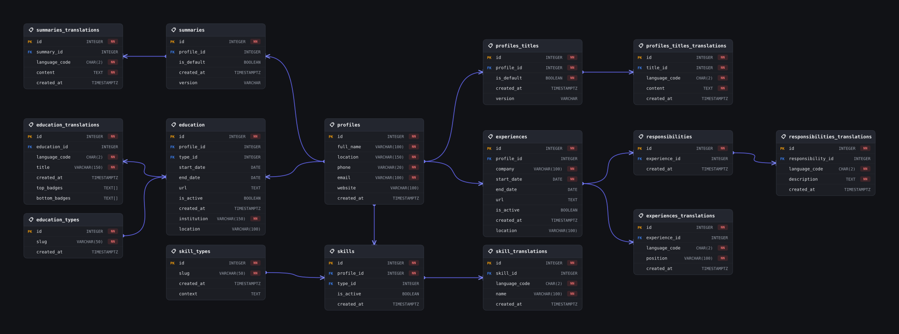

# Arquitectura de Base de Datos para Perfiles Multilingües

Este documento presenta la arquitectura técnica detallada de una base de datos diseñada para la gestión de perfiles profesionales con soporte de internacionalización (i18n) nativo. El diseño prioriza la integridad referencial y el desacoplamiento entre la estructura lógica de los datos y su representación en distintos idiomas.

## 📖 Tabla de Contenidos

- [📐 Introducción al Modelo Entidad-Relación (ERD)](#introducción-al-modelo-entidad-relación-erd)
- [🔗 Resumen de Cardinalidad y Relaciones](#resumen-de-cardinalidad-y-relaciones)
- [📖 Diccionario de Datos Detallado](#diccionario-de-datos-detallado)
- [🌐 Sistema de Internacionalización y Reglas de Integridad](#sistema-de-internacionalización-y-reglas-de-integridad)
- [🐘 Base de Datos PostgresSQL - Supabase](#base-de-datos-postgressql---supabase)
- [↩️ Regresar al README principal](../../README.md)

## 📐 Introducción al Modelo Entidad-Relación (ERD)

<figure align="center">
   
  <figcaption>
     <a href="https://dbdiagram.io/d/profiles-management-69fa525754a51d93d39b7377">🔗 Diagrama ERD, versión interactiva</a> 
     <a href="./assets/profiles-management.html">🔗 Diagrama ERD, versión interactiva</a> 
  </figcaption>
</figure>

 

El diseño de este esquema sigue un patrón de "núcleo y radios" (hub-and-spoke), donde la entidad `profiles` funciona como el nodo central de toda la arquitectura. De esta tabla raíz dependen jerárquicamente las entidades que componen la identidad profesional del usuario: resúmenes ejecutivos, competencias técnicas, experiencia laboral y formación académica.

Una característica fundamental de este modelo es la separación estricta entre metadatos estructurales y contenido literario. Mientras que las tablas base almacenan datos técnicos, fechas, URLs y relaciones de clasificación, el contenido textual susceptible de traducción se segrega en tablas con el sufijo `*_translations`. Este enfoque de normalización evita el crecimiento horizontal ineficiente de columnas (como `bio_en`, `bio_es`) y permite una escalabilidad ilimitada hacia nuevos idiomas sin alterar la lógica de negocio ni la estructura de las tablas principales.

## 🔗 Resumen de Cardinalidad y Relaciones

La siguiente tabla describe la interconectividad del sistema basada en el análisis de las claves foráneas y restricciones de unicidad definidas en el modelo:

| Entidad Origen | Entidad Destino | Cardinalidad | Definición Técnica Optimizada |
| --- | --- | --- | --- |
| `profiles` | `profiles_titles` | 1:N | FK con integridad referencial `DEFERRABLE` y borrado en cascada. |
| `profiles` | `summaries` | 1:N | FK con integridad referencial `DEFERRABLE` y borrado en cascada. |
| `profiles` | `skills` | 1:N | FK con integridad referencial `DEFERRABLE` y borrado en cascada. |
| `profiles` | `experiences` | 1:N | FK con borrado en cascada gestionado por índice. |
| `profiles` | `education` | 1:N | FK hacia perfil con soporte de transacciones diferidas y borrado en cascada. |
| `skill_types` | `skills` | 1:N | Protección de catálogo con `ON DELETE SET NULL`. |
| `experiences` | `responsibilities` | 1:N | Dependencia fuerte (Weak Entity) mediante FK con borrado en cascada. |
| `education_types` | `education` | 1:N | Protección de catálogo con `ON DELETE SET NULL`. |
| Tablas Base | Tablas `*_translations` | 1:N | Clave única compuesta mediante índice único en entidad y código de idioma (`language_code`). |

## 📖 Diccionario de Datos Detallado

### Grupo: Perfil e Identidad Directa

Este grupo gestiona la identidad básica y los canales de comunicación.

 

📋 **Tabla: `profiles`**

| Columna | Tipo | Restricciones | Descripción |
| --- | --- | --- | --- |
| `id` | IDENTITY | **PK** | Identificador único autoincremental (estándar SQL). |
| `full_name` | VARCHAR(100) | **NOT NULL** | Nombre completo del profesional. |
| `location` | VARCHAR(150) | **NOT NULL** | Ubicación o ciudad de residencia. |
| `phone` | VARCHAR(20) | **NOT NULL** | Número de teléfono de contacto. |
| `email` | VARCHAR(100) | **NOT NULL, UNIQUE** | Correo electrónico principal con índice único (`idx_profiles_email`). |
| `website` | VARCHAR(100) | **-** | URL del sitio web o portafolio personal. |
| `created_at` | TIMESTAMPTZ | **DEFAULT now()** | Marca de tiempo de creación con zona horaria. |

 

📋 **Tabla: `profiles_titles`**

| Columna | Tipo | Restricciones | Descripción |
| --- | --- | --- | --- |
| `id` | IDENTITY | **PK** | Identificador único autoincremental. |
| `profile_id` | INTEGER | **NOT NULL, FK** | Relación con la tabla `profiles` (`ON DELETE CASCADE DEFERRABLE`). |
| `is_default` | BOOLEAN | **NOT NULL, DEFAULT false** | Indica si es el título profesional predeterminado. |
| `created_at` | TIMESTAMPTZ | **DEFAULT now()** | Marca de tiempo de creación con zona horaria. |
| `version` | VARCHAR | **-** | Versión o variante del título. |                    |

### Grupo: Contenido Profesional

Gestiona la narrativa laboral y los hitos de carrera del perfil.

 

📋 **Tabla: `summaries`**

| Columna | Tipo | Restricciones | Descripción |
| --- | --- | --- | --- |
| `id` | IDENTITY | **PK** | Identificador único autoincremental. |
| `profile_id` | INTEGER | **FK** | Relación con la tabla `profiles` (`ON DELETE CASCADE DEFERRABLE`). |
| `is_default` | BOOLEAN | **DEFAULT false** | Indica si es el resumen predeterminado del perfil. |
| `created_at` | TIMESTAMPTZ | **DEFAULT now()** | Marca de tiempo de creación con zona horaria. |
| `version` | VARCHAR | **-** | Versión o variante del resumen. |

 

📋 **Tabla: `experiences`**

| Columna | Tipo | Restricciones | Descripción |
| --- | --- | --- | --- |
| `id` | IDENTITY | **PK** | Identificador único autoincremental. |
| `profile_id` | INTEGER | **FK** | Relación con la tabla `profiles` (`ON DELETE CASCADE DEFERRABLE`). |
| `company` | VARCHAR(100) | **NOT NULL** | Nombre de la empresa u organización. |
| `start_date` | DATE | **NOT NULL** | Fecha de inicio de la experiencia laboral. |
| `end_date` | DATE | **-** | Fecha de finalización (nulo si el puesto está activo). |
| `url` | TEXT | **-** | Enlace web relacionado con la experiencia. |
| `is_active` | BOOLEAN | **DEFAULT true** | Indica si la experiencia laboral sigue vigente. |
| `created_at` | TIMESTAMPTZ | **DEFAULT now()** | Marca de tiempo de creación con zona horaria. |
| `location` | VARCHAR(100) | **-** | Ubicación geográfica del puesto de trabajo. |

 

📋 **Tabla: `responsibilities`**

| Columna | Tipo | Restricciones | Descripción |
| --- | --- | --- | --- |
| `id` | IDENTITY | **PK** | Identificador único autoincremental. |
| `experience_id` | INTEGER | **FK** | Relación con la tabla `experiences` (`ON DELETE CASCADE DEFERRABLE`). |
| `created_at` | TIMESTAMPTZ | **DEFAULT now()** | Marca de tiempo de creación con zona horaria. |

### Grupo: Habilidades

Declara las habilidades. Note que las tablas de tipos no utilizan borrado en cascada para proteger la integridad de los catálogos.

 

📋 **Tabla: `skill_types` (Catálogos)**

| Columna | Tipo | Restricciones | Descripción |
| --- | --- | --- | --- |
| `id` | IDENTITY | **PK** | Identificador único autoincremental. |
| `slug` | VARCHAR(50) | **NOT NULL, UNIQUE** | Identificador textual único del tipo de habilidad (índice único `idx_skill_types_slug`). |
| `created_at` | TIMESTAMPTZ | **DEFAULT now()** | Marca de tiempo de creación con zona horaria. |
| `context` | TEXT | **-** | Contexto adicional o descripción del tipo de habilidad. |

 

📋 **Tabla: `skills`**

| Columna | Tipo | Restricciones | Descripción |
| --- | --- | --- | --- |
| `id` | IDENTITY | **PK** | Identificador único autoincremental. |
| `profile_id` | INTEGER | **NOT NULL, FK** | Relación con la tabla `profiles` (`ON DELETE CASCADE DEFERRABLE`). |
| `type_id` | INTEGER | **FK** | Relación con la tabla `skill_types` (`ON DELETE SET NULL`). |
| `is_active` | BOOLEAN | **DEFAULT true** | Estado de actividad de la habilidad. |
| `created_at` | TIMESTAMPTZ | **DEFAULT now()** | Marca de tiempo de creación con zona horaria. |

### Grupo: Educación Académica y Certificaciones

Define la taxonomía de grados académicos y certificaciones. Note que las tablas de tipos no utilizan borrado en cascada para proteger la integridad de los catálogos.

 

📋 **Tabla: `education_types`**

| Columna | Tipo | Restricciones | Descripción |
| --- | --- | --- | --- |
| `id` | IDENTITY | **PK** | Identificador único autoincremental. |
| `slug` | VARCHAR(50) | **NOT NULL, UNIQUE** | Identificador textual único del tipo de educación (índice único `idx_education_types_slug`). |
| `created_at` | TIMESTAMPTZ | **DEFAULT now()** | Marca de tiempo de creación con zona horaria. |

 

📋 **Tabla: `education`**

| Columna | Tipo | Restricciones | Descripción |
| --- | --- | --- | --- |
| `id` | IDENTITY | **PK** | Identificador único autoincremental. |
| `profile_id` | INTEGER | **FK** | Relación con la tabla `profiles` (`ON DELETE CASCADE DEFERRABLE`). |
| `type_id` | INTEGER | **FK** | Relación con la tabla `education_types` (`ON DELETE SET NULL`). |
| `start_date` | DATE | **-** | Fecha de inicio de los estudios. |
| `end_date` | DATE | **-** | Fecha de finalización o graduación. |
| `url` | TEXT | **-** | Enlace web relacionado con la institución o estudio. |
| `is_active` | BOOLEAN | **DEFAULT true** | Indica si los estudios se encuentran activos. |
| `created_at` | TIMESTAMPTZ | **DEFAULT now()** | Marca de tiempo de creación con zona horaria. |
| `institution` | VARCHAR(150) | **NOT NULL, DEFAULT ''** | Nombre de la institución educativa. |
| `location` | VARCHAR(100) | **-** | Ubicación geográfica de la institución. |

### Grupo de Traducciones

Todas las tablas de este grupo comparten la restricción *`UNIQUE`* compuesta por *[parent_id]* y *`language_code`* mediante un índice *`idx_..._lang`*, asegurando una sola versión por idioma.

 

📋 **Tabla: `profiles_titles_translations`**

| Columna | Tipo | Restricciones | Descripción |
| --- | --- | --- | --- |
| `id` | IDENTITY | **PK** | Identificador único autoincremental. |
| `title_id` | INTEGER | **NOT NULL, FK** | Relación con la tabla `profiles_titles` (`ON DELETE CASCADE DEFERRABLE`). |
| `language_code` | CHARACTER(2) | **NOT NULL** | Código de idioma ISO 639-1 (ej. 'es', 'en'). |
| `content` | TEXT | **NOT NULL** | Contenido traducido del título profesional. |
| `created_at` | TIMESTAMPTZ | **DEFAULT now()** | Marca de tiempo de creación con zona horaria. |

 

📋 **Tabla: `summaries_translations`**

| Columna | Tipo | Restricciones | Descripción |
| --- | --- | --- | --- |
| `id` | IDENTITY | **PK** | Identificador único autoincremental. |
| `summary_id` | INTEGER | **FK** | Relación con la tabla `summaries` (`ON DELETE CASCADE DEFERRABLE`). |
| `language_code` | CHARACTER(2) | **NOT NULL** | Código de idioma ISO 639-1. |
| `content` | TEXT | **NOT NULL** | Texto del resumen traducido. |
| `created_at` | TIMESTAMPTZ | **DEFAULT now()** | Marca de tiempo de creación con zona horaria. |

 

📋 **Tabla: `skill_translations`**

| Columna | Tipo | Restricciones | Descripción |
| --- | --- | --- | --- |
| `id` | IDENTITY | **PK** | Identificador único autoincremental. |
| `skill_id` | INTEGER | **FK** | Relación con la tabla `skills` (`ON DELETE CASCADE`). |
| `language_code` | CHARACTER(2) | **NOT NULL** | Código de idioma ISO 639-1. |
| `name` | VARCHAR(100) | **NOT NULL** | Nombre de la habilidad traducido. |
| `created_at` | TIMESTAMPTZ | **DEFAULT now()** | Marca de tiempo de creación con zona horaria. |

 

📋 **Tabla: `experiences_translations`**

| Columna | Tipo | Restricciones | Descripción |
| --- | --- | --- | --- |
| `id` | IDENTITY | **PK** | Identificador único autoincremental. |
| `experience_id` | INTEGER | **FK** | Relación con la tabla `experiences` (`ON DELETE CASCADE DEFERRABLE`). |
| `language_code` | CHARACTER(2) | **NOT NULL** | Código de idioma ISO 639-1. |
| `position` | VARCHAR(100) | **NOT NULL** | Nombre del puesto o cargo traducido. |
| `created_at` | TIMESTAMPTZ | **DEFAULT now()** | Marca de tiempo de creación con zona horaria. |

 

📋 **Tabla: `responsibilities_translations`**

| Columna | Tipo | Restricciones | Descripción |
| --- | --- | --- | --- |
| `id` | IDENTITY | **PK** | Identificador único autoincremental. |
| `responsibility_id` | INTEGER | **FK** | Relación con la tabla `responsibilities` (`ON DELETE CASCADE DEFERRABLE`). |
| `language_code` | CHARACTER(2) | **NOT NULL** | Código de idioma ISO 639-1. |
| `description` | TEXT | **NOT NULL** | Descripción de la responsabilidad traducida. |
| `created_at` | TIMESTAMPTZ | **DEFAULT now()** | Marca de tiempo de creación con zona horaria. |

 

📋 **Tabla: `education_translations`**

| Columna | Tipo | Restricciones | Descripción |
| --- | --- | --- | --- |
| `id` | IDENTITY | **PK** | Identificador único autoincremental. |
| `education_id` | INTEGER | **FK** | Relación con la tabla `education` (`ON DELETE CASCADE DEFERRABLE`). |
| `language_code` | CHARACTER(2) | **NOT NULL** | Código de idioma ISO 639-1. |
| `title` | VARCHAR(150) | **NOT NULL** | Título académico o de estudio traducido. |
| `created_at` | TIMESTAMPTZ | **DEFAULT now()** | Marca de tiempo de creación con zona horaria. |
| `top_badges` | TEXT[] | **-** | Arreglo de etiquetas o insignias superiores traducidas. |
| `bottom_badges` | TEXT[] | **-** | Arreglo de etiquetas o insignias inferiores traducidas. |

 

## 🌐 Sistema de Internacionalización y Reglas de Integridad

### Estrategia de Internacionalización

El sistema implementa el estándar ISO 639-1 mediante el uso del tipo de dato `CHAR(2)` para la columna `language_code`. Esta arquitectura es superior a la proliferación de columnas (denominada técnicamente como "Column Proliferation"), ya que permite filtrar el contenido mediante una única cláusula `WHERE` sin necesidad de alterar el esquema para soportar nuevos idiomas. La separación del contenido literario garantiza que la lógica de ordenamiento cronológico o filtrado por tipos se mantenga independiente del lenguaje en el que se visualice la información.

### Integridad Referencial y Mantenimiento Cascada

Para asegurar la consistencia absoluta de los datos, se ha implementado la cláusula `ON DELETE CASCADE` en todas las claves foráneas vinculadas a la entidad raíz `profiles`.

Este mecanismo garantiza que la eliminación de un perfil profesional resulte en una limpieza atómica y automática de todos los registros dependientes: información de contacto, experiencias, responsabilidades y todas sus respectivas traducciones. Esto elimina el riesgo de "orfandad de datos" y reduce la sobrecarga en la capa de aplicación, dejando que el motor de la base de datos gestione la integridad estructural de forma nativa y eficiente. El único caso exceptuado son los catálogos de tipos (`education_types` y `skill_types`), cuya persistencia es necesaria para la consistencia de otros perfiles existentes.

## 🐘 Base de Datos PostgresSQL - Supabase

Abarca todo lo que se es: formación, habilidades y trayectoria. Es "la identidad profesional" normalizada en tablas.

### Estructuración

Los scripts se encuentran organizados en la carpeta `./database/` bajo la siguiente jerarquía:

 

|Carpeta       |Descripción                               |
|--------------|------------------------------------------|
|./01-schema/  |Definición de tablas y relaciones (DDL).  |
|./02-logic/   |Vistas y funciones de procesamiento (RPC).|
|./03-security/|Aplicar RLS y politicas.                  |
|./04-seeds/   |Inserción para datos maestros.            |
|./functions/  |Edge Functions.                           |

 

> _**Nota**: Para una instalación limpia, ejecute los scripts en el orden numérico indicado en cada carpeta._

#### 1. Data Definition Language (DDL / schema)

1. [Extensions](./01-schema/01-extensions.sql)

2. [Base data tables](./01-schema/02-base-data-tables.sql)

3. [Translation tables](./01-schema/03-trannslation-tables.sql)

#### 2. Logica (logic)

1. [View profiles public](./02-logic/01-view-profiles-public.sql)

2. [RPC fetch full profile](./02-logic/02-rpc-fetch-full-profile.sql)

#### 3. Seguridad y Políticas (security)

1. [RLS enable all tables](./03-security/01-rls-enable-all-tables.sql)

2. [Policies public reading](./03-security/02-policies-public-reading.sql)

> _**Nota:** Siempre que modifique una tabla en `./01-schema/`, verifique si las políticas en `./03-security/` o las funciones en `./02-logic/` necesitan una actualización. La integridad del sistema depende de la sincronía entre estas tres capas."_

#### 4. Carga Inicial de Datos (DML / seeds)

La carga se realizará en dos etapas, asegurando que las llaves foraneas (los IDs) existan antes de insertar las traducciones.

Como se hara una carga inicial limpia, se prepararán los queries de SQL para pegarlos directamente el SQL Editor de Supabase, siendo más rápido y seguro que hacerlo por JS para una población masiva de datos.

1. [Master data base](./04-seeds/01-master-data-base.sql)

2. [Master data trsnslation](./04-seeds/02-master-data-trsnslation.sql)

#### 5. Edge Functions (functions)

- [get-profile](./functions/get-profile/index.ts)